<!-- Generated from profile.config.ts by `bun run build`. Edit that file, not this one. -->

<picture><source media="(prefers-color-scheme: dark)" srcset="https://raw.githubusercontent.com/GregoireF/GregoireF/output/hero-dark.svg"></picture>

  

I write the code and I run what's under it: front end, API, CI, the cluster it lands on. I learned most of it by breaking things and fixing them.

These days I build the developer tools I kept wishing I had. They're below, and you can run them from this page.

<picture><source media="(prefers-color-scheme: dark)" srcset="https://raw.githubusercontent.com/GregoireF/GregoireF/output/now-dark.svg"></picture>

<picture><source media="(prefers-color-scheme: dark)" srcset="https://raw.githubusercontent.com/GregoireF/GregoireF/output/section-tools-dark.svg"></picture>

<a href="https://github.com/GregoireF/kiwa">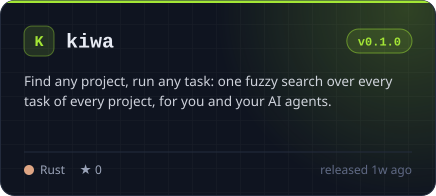</a> <a href="https://github.com/GregoireF/ship-it">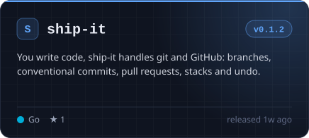</a> <a href="https://github.com/GregoireF/addlicense">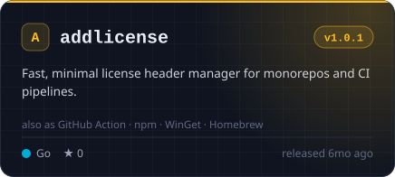</a> <a href="https://github.com/GregoireF/iac">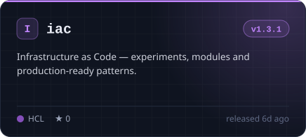</a>

<picture><source media="(prefers-color-scheme: dark)" srcset="https://raw.githubusercontent.com/GregoireF/GregoireF/output/section-play-dark.svg"></picture>

Each link opens an issue with a command in its title. Submit it, and a workflow installs the latest release, runs the command on a small demo folder and answers in the issue, usually within a minute. Where you see `<…>`, put your own text in the title first.

| Run | What you get |
| :-- | :-- |
| [`kw list`](https://github.com/GregoireF/GregoireF/issues/new?template=play.yml&title=run%3A%20kw%20list) | every project in a demo dev folder |
| [`kw about billing`](https://github.com/GregoireF/GregoireF/issues/new?template=play.yml&title=run%3A%20kw%20about%20billing) | what a project is and how to start it |
| [`kw info storefront`](https://github.com/GregoireF/GregoireF/issues/new?template=play.yml&title=run%3A%20kw%20info%20storefront) | the exact command behind each task |
| [`ship check title <…>`](https://github.com/GregoireF/GregoireF/issues/new?template=play.yml&title=run%3A%20ship%20check%20title%20feat(cart)%3A%20add%20vat%20rate) | is your commit title conventional? |
| [`ship branch feat <…>`](https://github.com/GregoireF/GregoireF/issues/new?template=play.yml&title=run%3A%20ship%20branch%20feat%20add%20dark%20mode) | the branch name ship would pick |
| [`addlicense --check .`](https://github.com/GregoireF/GregoireF/issues/new?template=play.yml&title=run%3A%20addlicense%20--check%20.) | which files lack a license header |

<picture><source media="(prefers-color-scheme: dark)" srcset="https://raw.githubusercontent.com/GregoireF/GregoireF/output/play-dark.svg"></picture>

<picture><source media="(prefers-color-scheme: dark)" srcset="https://raw.githubusercontent.com/GregoireF/GregoireF/output/section-radar-dark.svg"></picture>

<picture><source media="(prefers-color-scheme: dark)" srcset="https://raw.githubusercontent.com/GregoireF/GregoireF/output/radar-dark.svg"></picture>

<picture><source media="(prefers-color-scheme: dark)" srcset="https://raw.githubusercontent.com/GregoireF/GregoireF/output/section-activity-dark.svg"></picture>

<picture><source media="(prefers-color-scheme: dark)" srcset="https://raw.githubusercontent.com/GregoireF/GregoireF/output/stats-dark.svg"></picture>
<picture><source media="(prefers-color-scheme: dark)" srcset="https://raw.githubusercontent.com/GregoireF/GregoireF/output/skyline-dark.svg"></picture>

Languages and coding time

 

<picture><source media="(prefers-color-scheme: dark)" srcset="https://raw.githubusercontent.com/GregoireF/GregoireF/output/languages-dark.svg"></picture> <picture><source media="(prefers-color-scheme: dark)" srcset="https://raw.githubusercontent.com/GregoireF/GregoireF/output/wakatime-dark.svg"></picture>

<picture><source media="(prefers-color-scheme: dark)" srcset="https://raw.githubusercontent.com/GregoireF/GregoireF/output/section-stack-dark.svg"></picture>

<picture><source media="(prefers-color-scheme: dark)" srcset="https://raw.githubusercontent.com/GregoireF/GregoireF/output/stack-dark.svg"></picture>

<picture><source media="(prefers-color-scheme: dark)" srcset="https://raw.githubusercontent.com/GregoireF/GregoireF/output/section-work-dark.svg"></picture>

I'm open to full-time, freelance or contract work. Lille, Valenciennes or remote. Email is the quickest way to reach me: [gregoire.favreau@ik.me](mailto:gregoire.favreau@ik.me). I'm also on [LinkedIn](https://www.linkedin.com/in/gr%C3%A9goire-favreau-36a43444a/).

<a href="docs/how-it-works.md">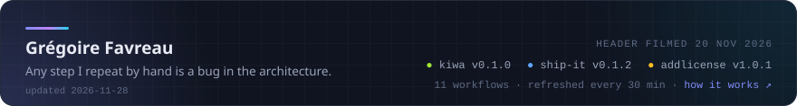</a>

