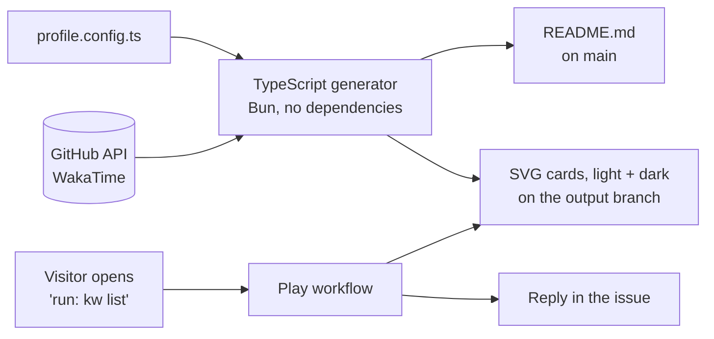

# How this profile works

The README you see on my profile is generated. Nothing on it is edited by hand except one config file, and nothing generated is ever committed to `main`.



## The pieces

**One config file.** [`profile.config.ts`](../profile.config.ts) holds the text, the showcased repos, the terminal session in the header and the commands visitors can run. It's typed, so a mistake fails before anything is published.

**A small generator.** [`src/`](../src) is plain TypeScript run by Bun. It has no runtime dependencies. Each card is a function that takes a theme and some data and returns an SVG string. Every card exists twice, `-dark.svg` and `-light.svg`, and the README picks the right one with `<picture>` and `prefers-color-scheme`. Animations are CSS only and switch off with `prefers-reduced-motion`.

**Two branches.** `main` holds the source and the README, and only my signed commits. The `output` branch holds the generated cards as a single commit that gets replaced on each run, so the history doesn't fill up with "update stats" commits.

**The README only changes when I change it.** It depends on the config and on which repos are showcased, nothing else. Numbers, dates and releases live in the cards. If a repo gets the `showcase` topic, CI notices that the README is out of date and opens an issue; I run `bun run build` and commit.

**The header is filmed, not written.** The loop at the top shows kiwa, ship-it and addlicense running on a small demo folder. Nothing in it is typed by hand: when a new release comes out (or the scenes in the config change), the Cards workflow installs the release, runs each command for real, records what it printed and how long it took, and draws the trailer from that. The footage is kept as `hero.json` on the `output` branch.

**One typeface everywhere.** Each SVG carries its own subset of Geist and Geist Mono (only the glyphs it uses, a few KB), so the cards look the same on every OS, and text is measured with the real font metrics so nothing overflows.

## Workflows

| Workflow | When | What |
| :-- | :-- | :-- |
| [Cards](../.github/workflows/cards.yml) | every 30 minutes, on push | renders every card and pushes `output` if something changed |
| [Play](../.github/workflows/play.yml) | an issue titled `run: …` | runs an allowlisted command on the latest release and replies |
| [Profile sync](../.github/workflows/sync.yml) | config changes | pushes bio, location, website, repo topics and labels to GitHub |
| [CI](../.github/workflows/ci.yml) | push, pull request | Biome, types, tests, README check, markdownlint, actionlint, zizmor |
| [Links](../.github/workflows/links.yml) | weekly | lychee checks every link |
| [Scorecard](../.github/workflows/scorecard.yml) | weekly | OpenSSF Scorecard |
| [CodeQL](../.github/workflows/codeql.yml) | push, pull request, weekly | security analysis of the generator and of the workflows |
| [Dependency review](../.github/workflows/dependency-review.yml) | pull request | blocks a vulnerable or badly licensed dependency |
| [Auto-heal](../.github/workflows/heal.yml) | any workflow ends | re-runs a failed job once, then opens an issue; closes it when green |
| [Keepalive](../.github/workflows/keepalive.yml) | monthly | keeps scheduled workflows from being switched off after 60 quiet days |
| [Dependabot auto-merge](../.github/workflows/automerge.yml) | Dependabot PR | merges updates once checks pass |

## The "run it here" part

Each link on the profile opens an issue whose title is a command. The [Play workflow](../.github/workflows/play.yml) does this:

1. The title is matched against the allowlist in the config. The command line is always taken from the config, never from the title. The only thing a visitor controls is one free-text argument for commands like `ship check title <…>`, and it's passed as a single argument with no shell in between. `@`, backticks and control characters are refused.
2. A first job with a read-only token downloads the latest release, checks it against the release checksums, and runs it with a throwaway `HOME`, no secrets in the environment and a 15 second limit, on [a small demo folder](../play/fixtures/dev).
3. A second job, which never runs visitor input, posts the output, closes and locks the issue, and redraws the "last run" card.

There's a limit of a few runs per person per hour.

## Run it yourself

```sh
bun install
bun run build     # writes README.md, renders every card into dist/, plus dist/cards.html and dist/profile.html
bun run preview   # same, then opens the profile preview
bun run check     # lint, types, dead code, tests, README in sync
```

Locally it uses your `gh` login to read the API. Fork it if you like; change `profile.config.ts` and the cards follow.
